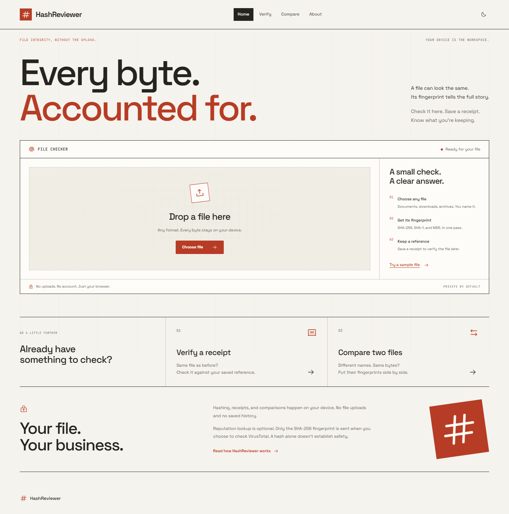
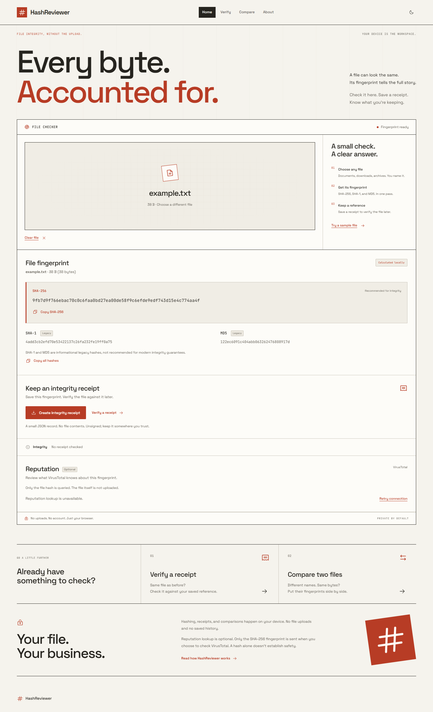
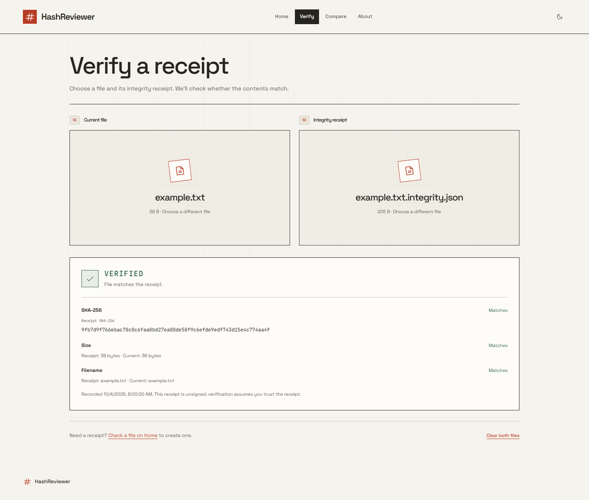
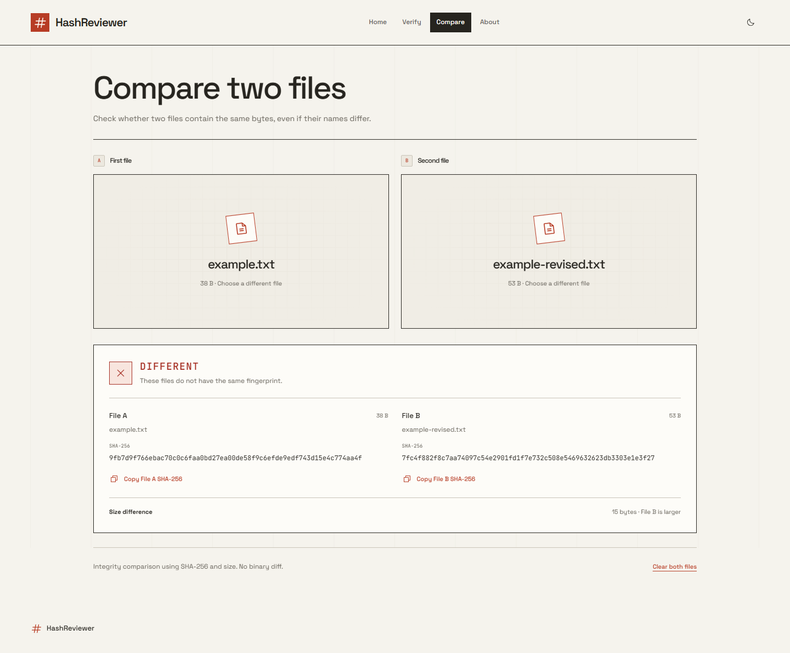

<h1 align="center">HashReviewer</h1>

Check file fingerprints, compare files and optionally review hash reputation without uploading file contents.

## Overview

**Is this the same file I expected, and is its fingerprint known to be suspicious?**

Drop a file, read its hashes, and save an integrity receipt. Later, verify it against the receipt or compare two files. All three workflows run locally in your browser. Reputation lookup is optional.

## Key features

| Workflow | What you get |
| --- | --- |
| Check a file on Home | SHA-256, SHA-1, MD5, filename, size, and copy actions |
| Integrity Receipt | A small, unsigned JSON record to download and verify later |
| Compare | IDENTICAL or DIFFERENT, both SHA-256 values, and size difference |
| Reputation | Optional VirusTotal hash lookup with counts and a concise explanation |

Navigation: **Home · Verify · Compare · About**. Home is the single file-checking workspace; existing `/check` links redirect there. No accounts, database, saved history, or file uploads.

The paper-and-vermilion interface puts the real file checker directly on the landing page. It includes light and dark themes and a subtle animated scan rule that runs automatically. Reduced-motion preferences are respected. See [interface design notes](docs/DESIGN.md).

## Screenshots

These images show the current interface with harmless demonstration files.

| Home | File check results |
| --- | --- |
|  |  |
| Verify | Compare |
|  |  |

## Core workflows and hashing model

1. Select or drop a file. A browser worker reads it in 4 MiB chunks.
2. The Home checker calculates all three hashes in one pass, with SHA-256 primary.
3. Create a receipt to record the expected fingerprint.
4. Verify checks SHA-256 and size. Filename changes are reported separately.
5. Compare checks both SHA-256 fingerprints and file sizes.
6. If reputation is configured, click "Check reputation" to query the fingerprint.

Hashing runs off the UI thread. Cancelling, replacing a file, or navigating away terminates its worker. Files are never executed.

## Integrity receipts

Receipts record metadata, **not the original file**. Downloads use the original filename followed by ".integrity.json".

~~~json
{
  "format": "hashreviewer.integrity-receipt",
  "version": 1,
  "filename": "example.txt",
  "size": 3,
  "sha256": "ba7816bf8f01cfea414140de5dae2223b00361a396177a9cb410ff61f20015ad",
  "createdAt": "2026-10-04T00:00:00.000Z"
}
~~~

Generated receipts also include informational SHA-1 and MD5 fields. They are optional on import; verification uses SHA-256 and size. Version 1 requires a UTC ISO timestamp, valid hex hashes, a nonnegative integer size, and only the documented fields. Imports are limited to 16 KiB.

**VERIFIED** means SHA-256 and size match. **CHANGED** means either differs. The result shows the recorded and current values. A renamed file can still verify.

Receipts are unsigned records, not certificates or cryptographic signatures. Keep the reference receipt somewhere you trust. Someone who can replace both file and receipt can defeat the check.

## Supported hashes

| Hash | Purpose |
| --- | --- |
| SHA-256 | Primary integrity fingerprint, receipts, comparison, reputation |
| SHA-1 | Informational legacy identifier |
| MD5 | Informational legacy identifier |

SHA-1 and MD5 are not recommended for modern integrity guarantees. Hashes do not establish authorship or determine safety.

## Privacy

- Hashing, receipts, verification, and comparison happen in the browser.
- File contents, filename, and size are never sent to the reputation backend.
- The backend availability check sends no file metadata.
- An explicit reputation lookup sends only SHA-256 to the backend and VirusTotal.
- There is no application history, database, analytics, local storage, or browser persistence.
- Downloaded receipts contain the filename and size. Share them thoughtfully.
- A hash can identify a known file. Hosting infrastructure and VirusTotal may observe queried hashes and network information.
- Opening an external report or the creator link visits that external site.

## Optional reputation

The optional FastAPI backend is a small same-origin proxy. It requests an existing report using VirusTotal's [GET file-report endpoint](https://docs.virustotal.com/reference/file-info). It has no file-submission endpoint.

The result shows malicious detections, suspicious classifications, undetected counts, analysis time when available, and "Why this result?". Reports with flags are labeled Suspicious. No known detections, Unknown, and No analysis available remain distinct; none means safe.

A hash reputation match is evidence about a known fingerprint and does not prove every contextual claim about a file. Reports can be stale, incomplete, or contain false positives.

Without a configured backend, reputation is unavailable and all local workflows work. Provider failures produce a simple availability error.

**API keys stay on the server.** Never place a private key in frontend source or a variable starting with VITE_. The proxy accepts SHA-256 only, does not follow provider redirects, and limits requests to four per minute per process by default. Provider daily quotas and usage terms still apply. Public deployments may need an additional gateway quota.

## Architecture

React and TypeScript provide the interface. A dedicated browser worker streams file chunks through incremental hash functions. Receipts and comparisons run locally; the only API requests are a metadata-free availability check and an explicitly requested SHA-256 reputation lookup. The optional FastAPI service holds the provider key and returns a small validated report. Static hosting alone supports every core workflow.

## Run locally

The core app requires Node.js 22.12+. Node.js 24 was used for validation.

~~~sh
cd frontend
npm ci
npm run dev
~~~

Open http://localhost:5173. No Python service or API key is required. In PowerShell, use npm.cmd if script execution policy blocks npm.ps1.

For optional reputation, use Python 3.12+ in another terminal, starting from the repository root:

~~~sh
python -m venv .venv
.venv/bin/python -m pip install -r backend/requirements.txt -e "./backend[dev]"
cp .env.example .env
~~~

Set HASHSENTRY_VIRUS_TOTAL_API_KEY in the root ".env" file, then run:

~~~sh
.venv/bin/python -m uvicorn app.main:app --app-dir backend --host 127.0.0.1 --port 8000 --no-access-log
~~~

On Windows, use ".venv\Scripts\python.exe" and "Copy-Item .env.example .env". The backend reads the root ".env" regardless of working directory.

Vite proxies "/api" to port 8000. VITE_API_PROXY_TARGET can change the development/preview proxy target; it is a URL, never a credential.

## Build and deployment

~~~sh
cd frontend
npm run build
npm run preview
~~~

Production files are written to frontend/dist. Serve them at an HTTPS site's root and rewrite routes such as "/verify" to index.html. The core needs no backend. Serve over HTTP(S), not a file URL.

For reputation, route "/api" to the backend on the **same origin** and keep the key in server environment variables. See [deployment details](docs/DEPLOYMENT.md).

Docker runs the static app by default, with an optional reputation profile:

~~~sh
docker compose up --build
# After setting the backend key in .env:
docker compose --profile reputation up --build
~~~

The UI listens on http://localhost:8080. No Redis, database, migration, or worker service is required.

## Testing

~~~sh
cd frontend
npm test
npm run lint
npm run build
npx playwright install chromium
npm run e2e
npm run e2e:production
npm run screenshots
~~~

Backend checks with development dependencies installed:

~~~sh
cd backend
../.venv/bin/python -m pytest
../.venv/bin/python -m ruff check .
~~~

On Windows, use "..\.venv\Scripts\python.exe". Browser tests use an isolated server on port 5180. Provider tests use synthetic reports and do not require a real key. See [testing and validation](docs/TESTING.md) and the [changelog](CHANGELOG.md).

## Limitations

- Integrity depends on a trusted receipt and SHA-256's collision resistance.
- Receipts are unsigned. Comparison does not provide a binary diff.
- Legacy hashes are informational.
- Reputation is evidence, not antivirus scanning or a safety guarantee.
- Large files take time proportional to size and device performance. There is no arbitrary upload-size cap.
- The core works without reputation network access once loaded. There is no installable offline app or service worker cache.
- Browsers may restrict clipboard access; displayed hashes remain selectable.
- Rate limits are in memory per process. Multiple instances need a shared gateway quota.

## License and author

Released under the [MIT License](LICENSE).

Designed and built by [Mosaddiqur Rahman ↗](https://www.linkedin.com/in/mosaddiqur/).
